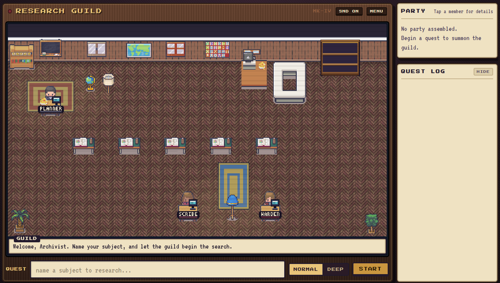
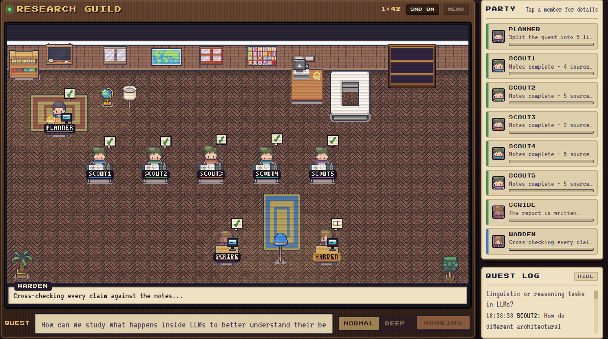
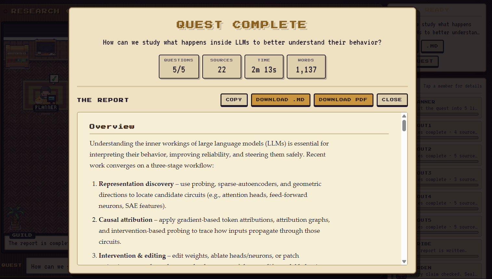
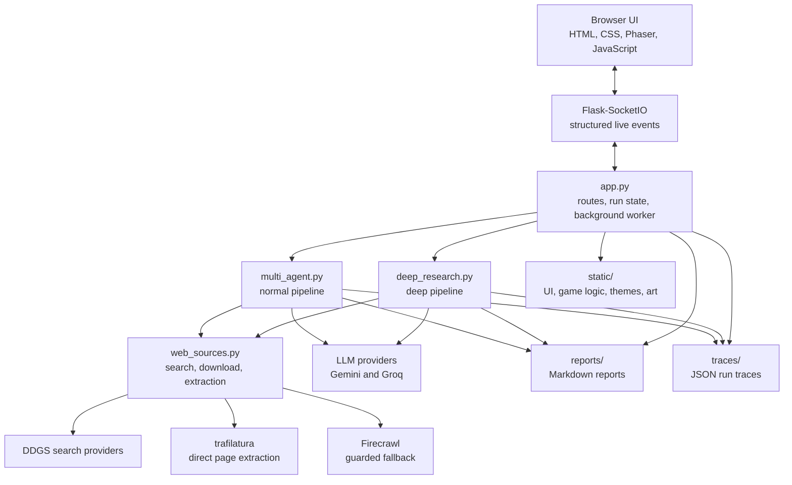

# Research Guild

Research Guild is a browser-based research workspace presented as a small
pixel-art guild hall. A planning agent breaks a topic into questions, scout
agents research those questions in parallel, and the synthesizer and verifier
turn the collected material into a cited Markdown report.

The interface is deliberately visual: each agent has a role, a location, a
status, and a live activity in the room. The report archive is available from
the same screen after a run completes.

It is designed to make the research process visible without turning it into a
black box. Instead of waiting for one long model response, you can watch the
planner divide the work, see the scouts leave for their desks, follow the
scribe as it assembles the findings, and watch the warden perform the final
check.

## Screenshots

### Guild hall

The research team works inside the pixel-art guild hall, with each agent's
position reflecting its current role.



### Live research progress

The interface shows agent activity and research progress in real time.



### Completed report

Completed research is presented as a cited report and can be downloaded as a
PDF.



## What it does

- Accepts a research topic from the browser.
- Supports normal and deep research modes.
- Splits a topic into focused sub-questions before research begins.
- Runs one scout per sub-question, with two to five scouts depending on the
  breadth of the topic.
- Searches the web through free sources first.
- Uses direct page extraction before guarded Firecrawl fallback.
- Uses LLMs for planning, synthesis, and verification.
- Streams structured progress events to the browser over Socket.IO.
- Saves reports as Markdown and run traces as JSON.
- Exports the completed report as a print-styled PDF from the browser.
- Provides an archive for reopening and downloading completed reports.

## How a quest unfolds

### 1. The planner scopes the topic

The planner does not send every topic through the same fixed workflow. It
chooses between two and five focused sub-questions based on how broad or
narrow the request is. A compact question may need only two scouts, while a
topic with several distinct angles can use four or five. This keeps small
research tasks from becoming unnecessarily expensive while still giving larger
questions room to be investigated properly.

Each sub-question is written as its own line of inquiry. The questions are
intended to cover different parts of the topic rather than repeat the same
search from slightly different wording. For example, a question about heat
pumps might be divided into cold-weather performance, installation
requirements, operating costs, and limitations.

### 2. The scouts research in parallel

Once the plan is ready, the browser creates the matching number of scout
agents. Four scouts instead of five is not a missing agent or a failed run:
the planner may decide that four lines of inquiry are enough. Each scout
searches for its own question, collects usable pages, extracts readable text,
and turns the results into notes with source links.

The sourcing layer tries free search and direct downloads first. Pages that
cannot be read reliably may go through the guarded Firecrawl fallback, while
blocked or low-quality pages are filtered out. In deep mode, relevant passages
are selected from across a page instead of relying only on the opening text.

### 3. The scribe builds one report

The scribe receives the scouts' notes rather than raw search results. It
combines overlapping findings, keeps the source trail, and turns separate
answers into a readable report. In normal mode this is a compact synthesis. In
deep mode, the planner can send follow-up questions when the first pass leaves
gaps, after which the scribe writes a longer paper-style report.

### 4. The warden checks the result

The warden reviews the finished report against the gathered evidence. It looks
for unsupported claims, weak citation coverage, contradictions, and missing
sections. The result is saved as Markdown, accompanied by a JSON trace of the
run, and can be reopened from the archive or printed as a report-only PDF.

The guild hall reflects these stages as they happen. Positions are meaningful:
scouts work at their desks, agents move when they hand off findings, and the
party gathers around the table after a completed quest.

## Agent workflow

The guild has four logical roles:

- **Planner**: creates the research plan and coordinates the run.
- **Scouts**: investigate the plan's sub-questions in parallel.
- **Scribe**: synthesizes the collected notes into a report.
- **Warden**: checks the report structure, evidence, and citations.

```mermaid
flowchart LR
    User[User enters a topic] --> Planner[Planner creates sub-questions]
    Planner --> Scouts[Scout agents research in parallel]
    Scouts --> Sources[Search and page extraction]
    Sources --> Notes[Evidence and source notes]
    Notes --> Scribe[Scribe synthesizes report]
    Scribe --> Warden[Warden verifies report]
    Warden --> Report[Markdown report and JSON trace]
    Report --> Browser[Live UI and archive]
```



Normal mode follows this path with one focused research pass. Deep mode keeps
the same roles but adds time-boxed planning, evidence extraction, a gap-filling
round when useful, section drafting, and a final fact-check before the report
is assembled. The deep run is capped so it can still finish with a report
instead of waiting indefinitely on a single model or source.

## Project architecture



## Tech stack

### Backend

- **Python** — pipeline orchestration and server-side research logic.
- **Flask** — HTTP server and HTML template rendering.
- **Flask-SocketIO** — live bidirectional progress updates.
- **Gunicorn** — production process server on Railway.
- **python-dotenv** — local environment-variable loading.
- **ThreadPoolExecutor** — parallel scout work in normal mode.

### Research and AI services

- **Groq** — model calls for planning, research assistance, synthesis, and
  verification.
- **Google Gemini** — configured as an additional model provider for the
  research pipeline.
- **DDGS** — free web search across supported search providers.
- **trafilatura** — readable text extraction from directly downloaded pages.
- **Firecrawl** — guarded fallback for pages that cannot be downloaded
  directly.
- **Europe PMC** — free scientific literature retrieval used where relevant.

### Frontend

- **HTML and CSS** — application shell, report views, archive, and responsive
  layout.
- **JavaScript** — browser controller, Socket.IO event handling, report
  rendering, PDF export, and application state.
- **Phaser** — pixel-art guild hall scene, movement, animations, and depth
  sorting.

## Repository layout

```text
.
├── app.py                    Flask and Socket.IO server
├── multi_agent.py            Normal research pipeline
├── deep_research.py          Deep research pipeline
├── web_sources.py            Search and page extraction layer
├── requirements.txt          Python dependencies
├── templates/
│   └── index.html            Main application page
├── static/
│   ├── css/app.css           UI styles
│   ├── js/app.js             Browser controller
│   ├── js/game.js            Guild hall behavior
│   ├── js/world.js           Floorplan, zones, and pathfinding
│   └── js/pixel-art.js       Procedural fallback artwork
├── tests/
│   ├── game.test.js          Headless game behavior tests
│   ├── world.test.js         Floorplan and pathfinding tests
│   └── browser/              Browser-level checks
├── reports/                  Generated Markdown reports
└── traces/                   Generated JSON traces
```

## Local setup

### Requirements

- Python 3.11 or newer
- Node.js 18 or newer for the JavaScript test suites
- API keys for the configured model and retrieval services

### Install Python dependencies

Create and activate a virtual environment, then install the dependencies:

```powershell
python -m venv .venv
.venv\Scripts\Activate.ps1
pip install -r requirements.txt
```

### Configure environment variables

Copy `.env.example` to `.env` and fill in the values locally:

```powershell
Copy-Item .env.example .env
```

Required variables:

```env
FIRECRAWL_API_KEY=...
GEMINI_API_KEY=...
GROQ_API_KEY=...
FLASK_SECRET_KEY=...
FLASK_DEBUG=true
CORS_ALLOWED_ORIGINS=http://127.0.0.1:5000
PORT=5000
```

Never commit `.env`. It is excluded by `.gitignore`.

### Start the development server

```powershell
python app.py
```

Open [http://127.0.0.1:5000](http://127.0.0.1:5000).

## Tests

The logic tests do not require a browser or an API run:

```powershell
node tests\game.test.js
node tests\world.test.js
```

The browser checks require Playwright and a running local server. See
[`tests/browser/README.md`](tests/browser/README.md) for the available checks.
The `deep-run.js` browser check performs a real model run and may consume API
quota.

## Deployment

The live application is designed to run as one long-lived Python service. The
current deployment uses Railway with Gunicorn:

```text
gunicorn --worker-class gthread --threads 10 --workers 1 --bind 0.0.0.0:$PORT app:app
```

The single worker is intentional. Active-run state and the current event
history are held in process memory. Running multiple workers without shared
state would give different clients inconsistent views of a run.

Set these variables in the hosting provider rather than committing them:

```text
FIRECRAWL_API_KEY
GEMINI_API_KEY
GROQ_API_KEY
FLASK_SECRET_KEY
FLASK_DEBUG=false
CORS_ALLOWED_ORIGINS=https://your-deployment-domain
```

The local `reports/` and `traces/` folders are suitable for a small demo, but
cloud filesystems may be ephemeral. A production service that must retain its
archive should move report and trace storage to a persistent volume, object
storage, or a database.

## Security and configuration notes

- Keep all API keys in environment variables.
- Keep `.env` out of Git.
- Use a random `FLASK_SECRET_KEY` in deployment.
- Set `FLASK_DEBUG=false` in deployment.
- Restrict `CORS_ALLOWED_ORIGINS` to the deployed origin.
- Protect a public deployment with authentication and rate limiting before
  exposing it to untrusted users.
- Monitor model, search, and Firecrawl quotas. Firecrawl is intentionally used
  only as a guarded fallback.

## License

Research Guild is released under the MIT License. You can use it, change it,
and build on it for personal or commercial projects. Keep your API keys out of
the repository and configure your own environment variables before deploying.
